# LeonToon

Estudio de animación 2D de escritorio, hecho en Rust con egui. Mezcla ideas de los programas de animación tradicional,
de motion graphics y de stop motion (salas de trabajo, mesa de luz, papel cebolla, línea de tiempo de montaje, hoja de
exposición, Live View) con un motor propio de dibujo **vectorial** y de **píxeles**. Está en desarrollo activo; la versión
actual es la **0.3.0**.

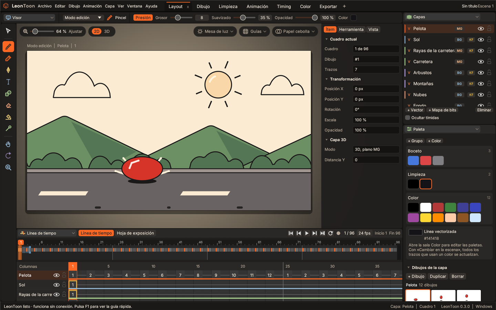

Todas las imágenes salen del **proyecto de muestra** que trae el programa: una pelota que rebota (animación tradicional, a dos cuadros), un sol que va y viene (interpolación) y un paisaje con paralaje en bucle de cuatro segundos, con cielo, nubes, montañas, arbustos y carretera. Se abre desde la pantalla de inicio.`n`n**Contenido:** [Dibujo](#dibujo) · [Interfaz](#interfaz-por-editores) · [Montaje y motion graphics](#montaje-y-motion-graphics) ·
[Stop Motion](#stop-motion) · [Storyboard y animatic](#storyboard-y-animatic) · [Exportar](#exportar) ·
[Descargar](#descargar) · [Compilar](#compilar) · [Estado y límites](#estado-y-límites)

## Dibujo

- **Lápiz vectorial** (L) con grosor por presión, perfiles de grosor (afilado o dibujado con puntos), extremos y uniones, y una biblioteca de 22 pinceles con vista previa, favoritos, buscador y paquetes `.ltvb` para importar y exportar.
- **Pluma Bézier** (P) con nodos y tiradores; los trazos libres se pueden convertir en curvas.
- **Edición no destructiva**: se eligen uno o varios trazos para cambiar grosor, color, opacidad, perfil o pincel sin volver a dibujarlos, y se puede restaurar el aspecto original.
- **Capas de mapa de bits** con un motor de pinceles de píxeles (dureza, espaciado, dinámica de forma y de transferencia, dispersión, textura, doble pincel, bordes húmedos, puntas de imagen) e importación y exportación de pinceles `.abr` de Photoshop.
- **Mesa de luz** con luz, temperatura, papel cebolla y **papeles de estudio** (Bond, Genga, TMK y otros) con grano orgánico cuya intensidad sigue la luz.

| | |
|---|---|
|  |  |
| **Biblioteca de pinceles**: vista previa, favoritos y paquetes `.ltvb` | **Edición de trazos**: un solo panel para el Lápiz y para lo elegido |
| 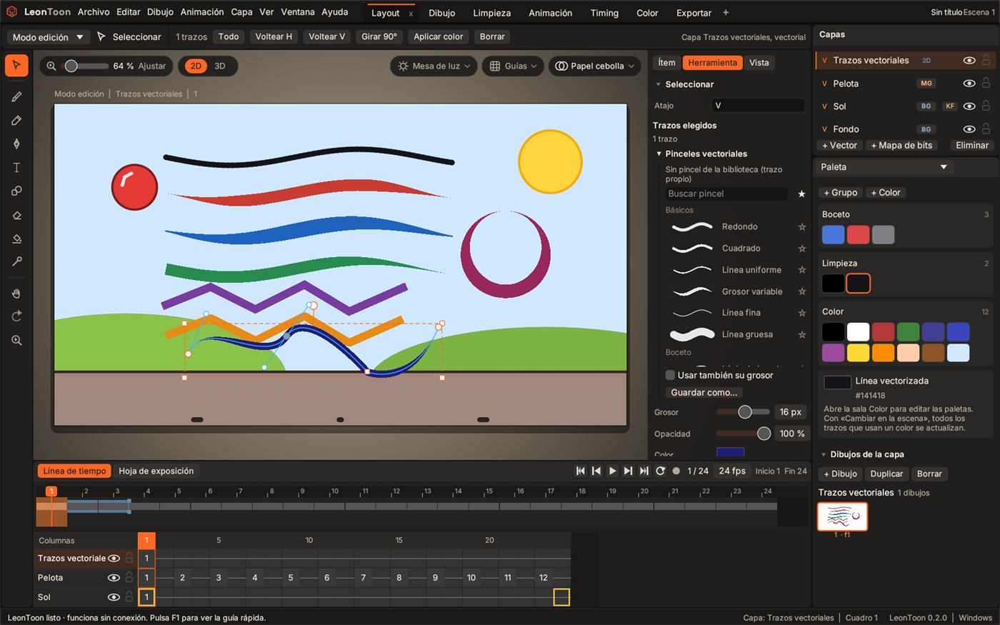 | 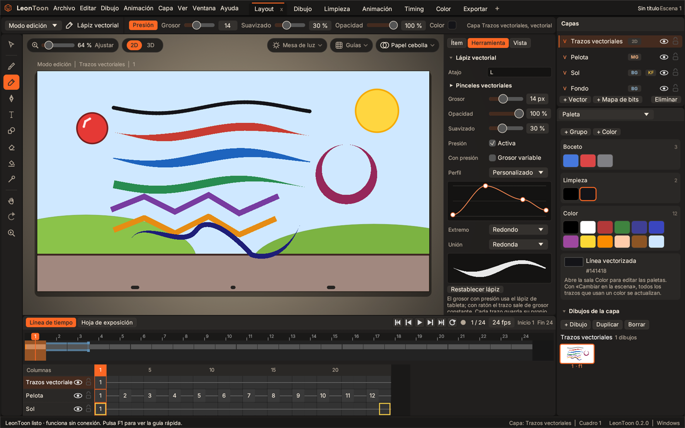 |
| **Pluma y nodos**: curvas Bézier editables | **Perfil de grosor** dibujado con puntos |
|  |  |
| **Pinceles de píxeles** con presets y dinámicas | **Papeles de estudio** con grano que responde a la luz |

## Interfaz por editores

La pantalla se divide en **huecos** y cada hueco muestra el **editor** que elijas (visor, capas, propiedades, línea de tiempo,
X-Sheet, storyboard…), como en Blender. Cada sala trae su propia disposición, pero se puede cambiar. La barra de herramientas
tiene iconos con color y los ajustes de la herramienta elegida están en la barra lateral **N**, pestaña *Herramienta*.

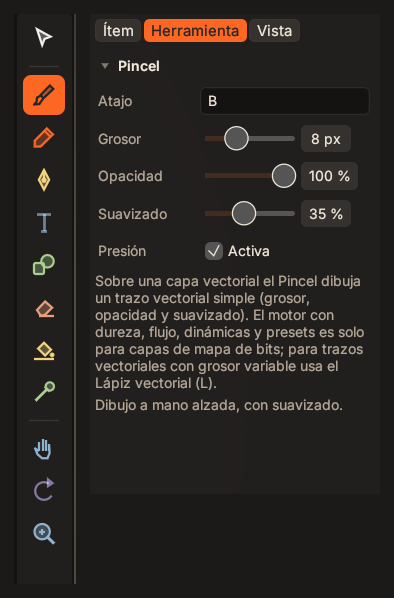

Al abrir el programa, la pantalla de inicio ofrece un archivo nuevo según el tipo de animación (storyboard, animatic,
animación tradicional, cutout, motion graphics o stop motion), cada uno con su conjunto de salas.

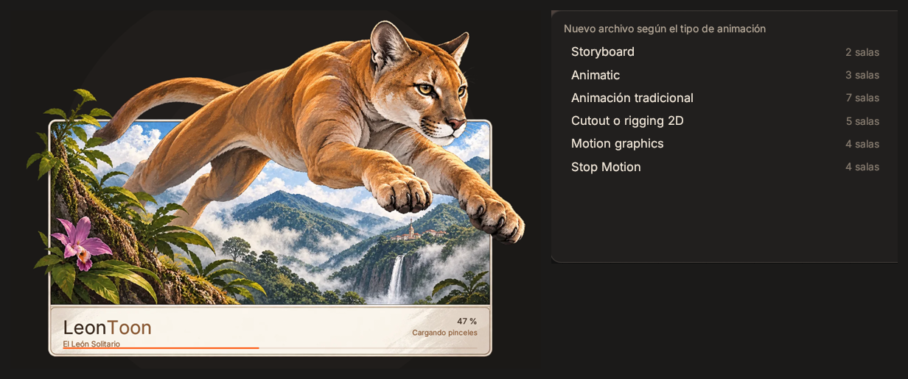

El selector de cada hueco agrupa los editores por familia, con su icono:

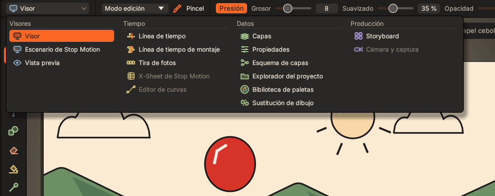

## Montaje y motion graphics

La **línea de tiempo de montaje** es un editor propio para motion graphics: una fila por capa con barra de duración,
interruptores (visible, solo, bloqueo, tímida), etiqueta de color y, al desplegar la capa, una pista por propiedad
(punto de anclaje, posición, escala, rotación, opacidad y profundidad) con sus propias claves.

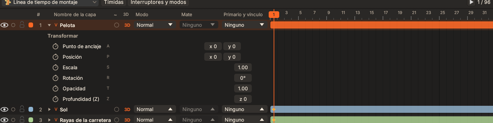

**Fusión y vínculo.** Cada capa tiene modo de fusión (Multiplicar, Diferencia y otros ocho modos), mate y un *primario*:
una capa puede heredar la transformación de otra. En la imagen, las Montañas y las Nubes están en Multiplicar y los Arbustos tienen a las Montañas como primario.

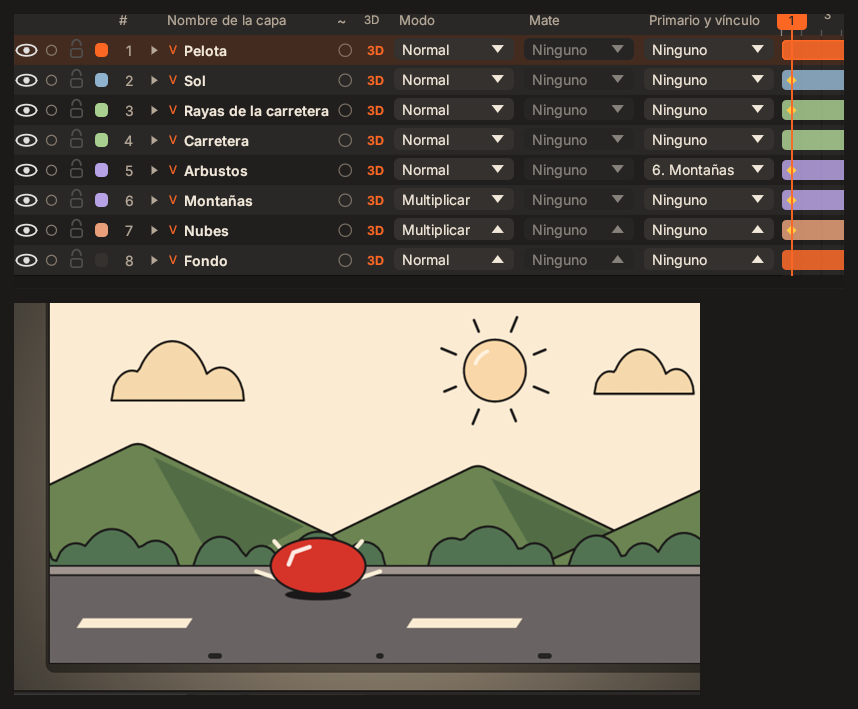

**Colecciones.** Las capas se agrupan en colecciones anidables sin límite, arrastrando capas dentro de ellas, y la vista 3D
dibuja cada colección como un cubo de líneas punteadas.

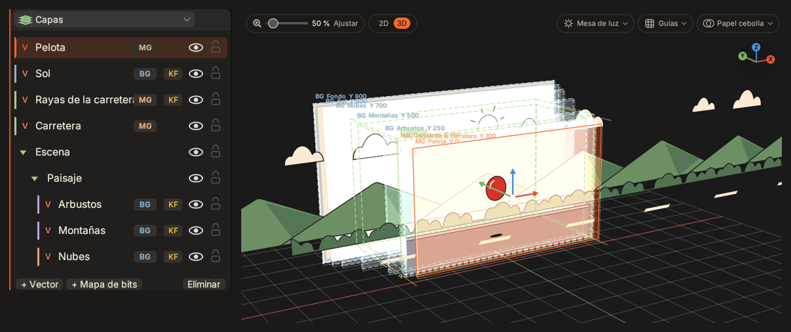

**Propiedades de capa y espacio 2D/3D.** La selección múltiple (Ctrl y Mayús) permite agrupar varias capas. Cada capa puede
ser 2D o 3D, con profundidad animable, y se coloca en fondo, medio o primer plano.

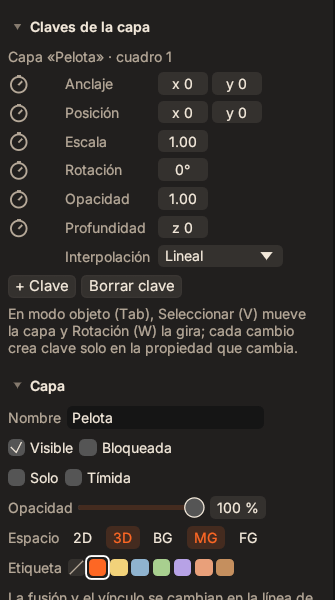

**Precomposición.** Un grupo de capas se convierte en su propia composición; se entra en ella para editarla y se sale con
*Salir*, y la ruta (Escena › Precomp 1) queda a la vista.

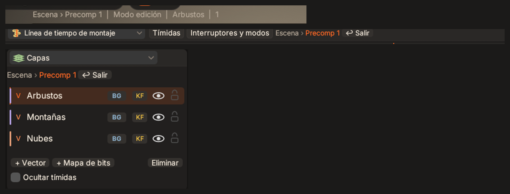

## Stop Motion

La sala de Stop Motion se parece a un programa de captura: el escenario con su *Live View* arriba, controles de reproducción,
y alrededor las hojas de exposición y la tira de fotos.

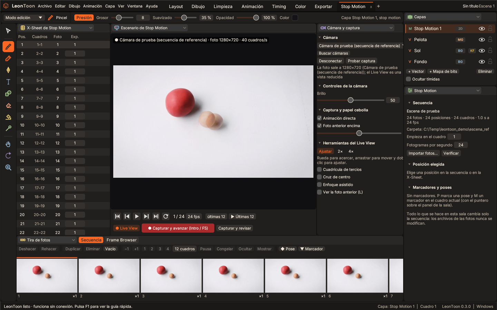

- **Cámara y captura**: elegir cámara, brillo, *animación directa*, foto anterior encima con opacidad, y herramientas del Live View (ajustar, 2×, 4×, cuadrícula de tercios, cruz de centro, enfoque asistido, ver foto anterior con L).
- **Capturar y avanzar** con Intro o F5, o capturar y revisar.

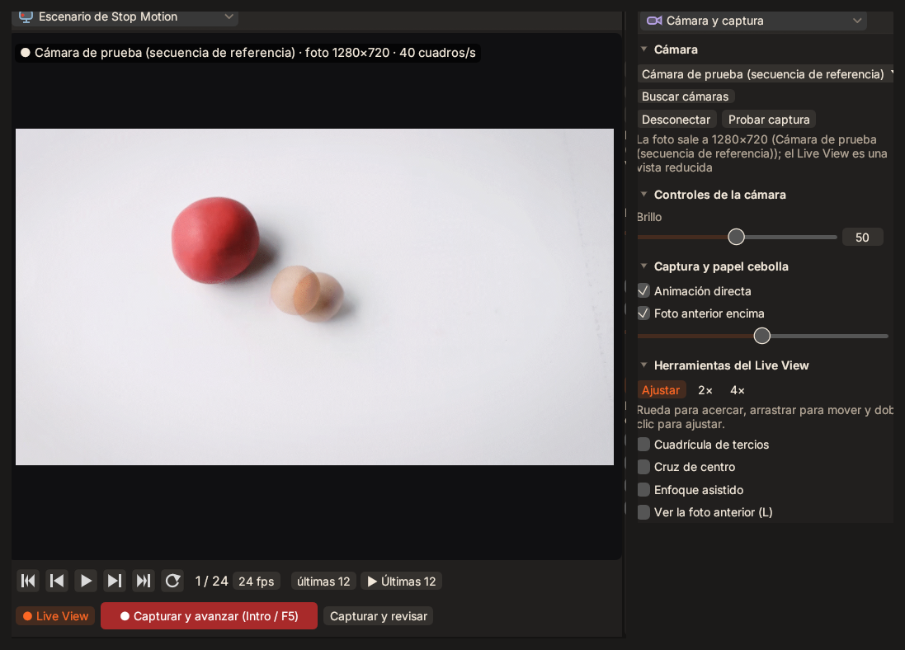

**X-Sheet**: la hoja de exposición muestra posición, cuadros, foto y exposición (cuántos cuadros dura cada foto).

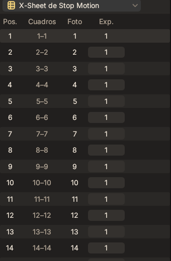

**Tira de fotos** con secuencia y *Frame Browser*; duplicar, eliminar, vaciar, congelar, ocultar y poses o marcadores.

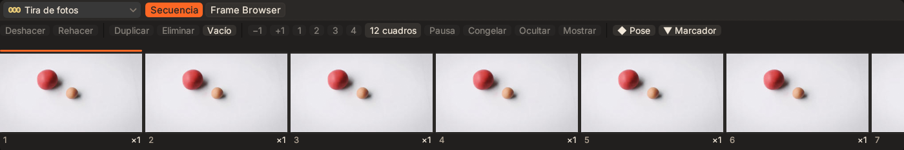

## Storyboard y animatic

El **storyboard** muestra los planos como miniaturas con nombre y duración; se reordenan arrastrando y *Animatic > Xsheet*
los lleva a la hoja de exposición.

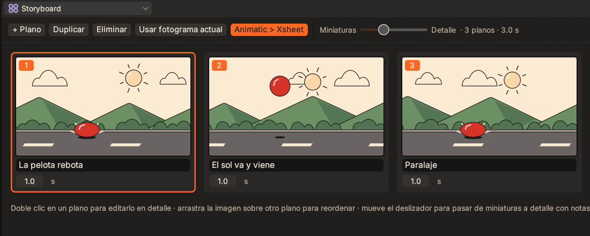

El **animatic** es una composición de planos con transiciones (corte, fundido…). Cada plano es una capa de la línea de
tiempo de montaje, y la lista de planos del panel permite cambiar la duración y la transición.

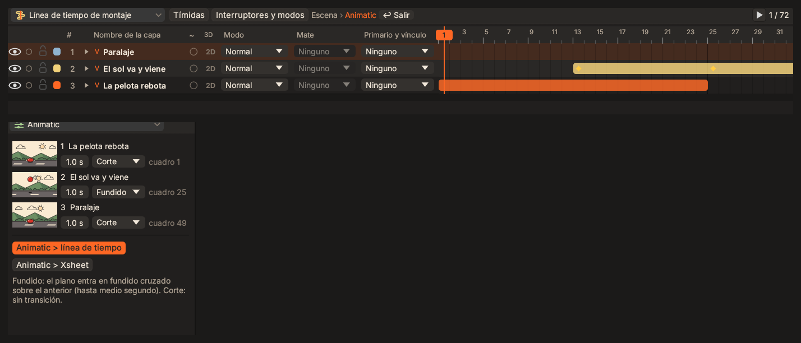

## Exportar

PNG, GIF y MP4 (para MP4 hace falta [ffmpeg](https://ffmpeg.org/) aparte). Los proyectos se guardan como `.ltoon`.

## Descargar

Las versiones para Windows están en [Releases](https://github.com/jonathanleongonzalez87/LeonToon/releases): descarga el `.zip`,
descomprímelo y abre `LeonToon.exe`. Como el programa aún no está firmado, Windows puede mostrar un aviso de SmartScreen:
pulsa «Más información» y luego «Ejecutar de todos modos».

Al abrirlo, **F1** muestra la guía rápida. Atajos principales: **V** Selección, **L** Lápiz vectorial, **P** Pluma,
**B** Pincel, **T** barra de herramientas, **N** barra lateral, **Mayús+A** agregar capa.

## Compilar

Hace falta [Rust](https://www.rust-lang.org/tools/install) estable.

```powershell
cargo run --release --manifest-path app/Cargo.toml
```

Para las pruebas: `cargo test --manifest-path app/Cargo.toml`. El icono del `.exe` lo incrusta `app/build.rs` con
`windres`; si no está disponible, el programa se compila igual, sin icono de archivo.

## Estado y límites

LeonToon está en construcción. Entre lo que todavía falta o no se ha probado a fondo:

- La presión de **tableta gráfica** no se ha probado con hardware real, y la inclinación del lápiz no está disponible.
- Los `.abr` exportados no se han abierto todavía en Photoshop.
- La captura con **cámara real** en Stop Motion depende del dispositivo; las imágenes de este README usan una secuencia de fotos de referencia (`referencia/Sec_Ref_Stop_Motion`) en lugar de la cámara.
- Pendientes: importar **video y audio** al montaje, herramienta Texto, rigging, luz y profundidad de campo en 3D, sonido, exportar con la cámara 3D.

## Documentación y desarrollo

Notas de diseño en [`docs/`](docs): [arquitectura de editores](docs/arquitectura-editores.md),
[editor de tiempo de montaje](docs/editor-de-tiempo-montaje.md) y [Stop Motion de estudio](docs/stop-motion-estudio.md).

El trabajo se organiza con [Issues](https://github.com/jonathanleongonzalez87/LeonToon/issues) (con etiquetas de área, tipo y
prioridad, y hitos por versión) y se entrega con Pull Requests. Para publicar una versión, ver [RELEASING.md](RELEASING.md).
Las plantillas de Issue y de PR están en `.github/`.
