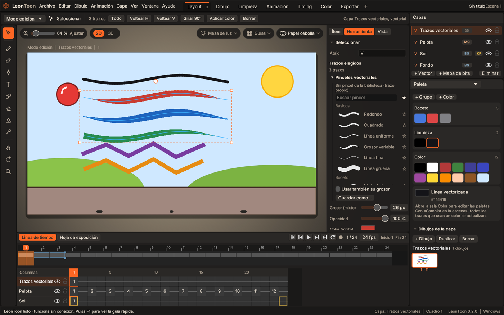
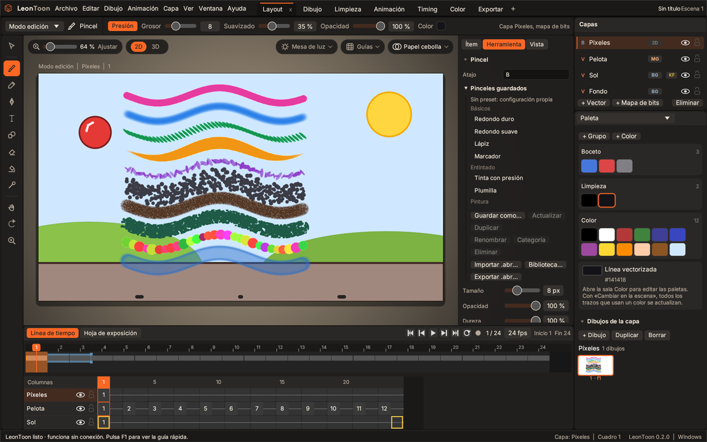
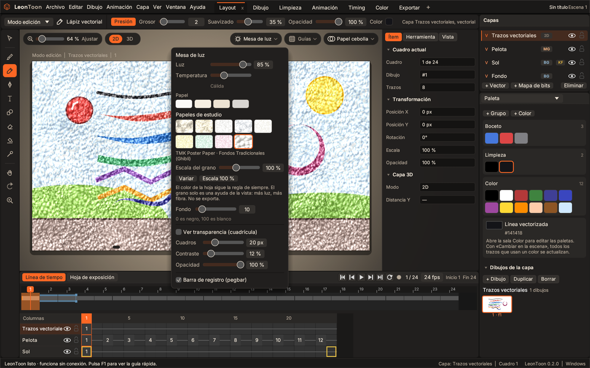
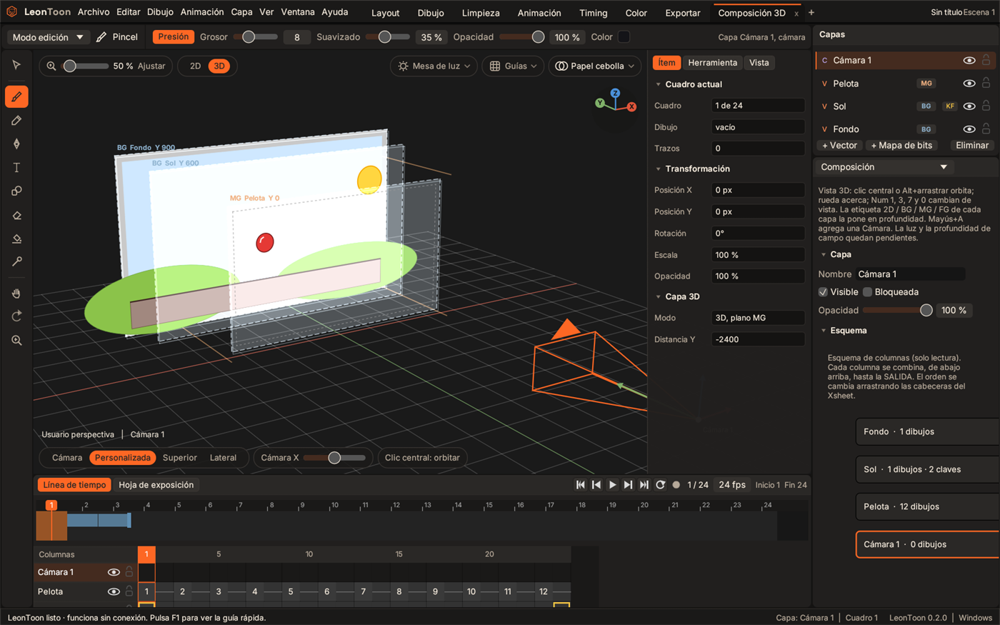

# LeonToon

Estudio de animación 2D de escritorio, hecho en Rust con egui. Mezcla ideas de los programas de animación tradicional y
digital (salas de trabajo, mesa de luz, papel cebolla, línea de tiempo y hoja de exposición) con un motor propio de
dibujo **vectorial** y de **píxeles**. Está en desarrollo activo; la versión actual es la 0.2.0.


## Qué se puede hacer hoy

- **Dibujo vectorial** con el Lápiz (L): grosor por presión, perfiles de grosor (afilado o dibujado con puntos), extremos y uniones, y una biblioteca de 22 pinceles con vista previa, favoritos, buscador y paquetes `.ltvb` para importar y exportar.
- **Pluma Bézier** (P) con nodos y tiradores, y edición de nodos; los trazos libres se pueden convertir en curvas.
- **Edición no destructiva**: se eligen uno o varios trazos para cambiar grosor, color, opacidad, perfil o pincel sin volver a dibujarlos, y se puede restaurar el aspecto original.
- **Capas de mapa de bits** con un motor de pinceles de píxeles (dureza, espaciado, dinámica de forma y de transferencia, dispersión, textura, doble pincel, bordes húmedos, puntas de imagen) e importación y exportación de pinceles `.abr` de Photoshop.
- **Mesa de luz** con luz, temperatura, papel cebolla y **papeles de estudio** (Bond, Genga, TMK y otros) con grano orgánico cuya intensidad sigue la luz.
- **Vista 3D** de composición con planos de fondo, medio y primer plano, y cámara.
- Línea de tiempo, hoja de exposición, claves, storyboard y animatic.
- Exportar a PNG, GIF y MP4 (para MP4 hace falta [ffmpeg](https://ffmpeg.org/) aparte). Los proyectos se guardan como `.ltoon`.

| | |
|---|---|
|  |  |
| **Edición de trazos**: un solo panel para el Lápiz y para lo elegido | **Pluma y nodos**: curvas Bézier editables |
|  |  |
| **Perfil de grosor** dibujado con puntos | **Pinceles de píxeles** con presets y dinámicas |
|  |  |
| **Papeles de estudio** con grano que responde a la luz | **Vista 3D** de planos y cámara |

## Descargar

Las versiones para Windows están en [Releases](https://github.com/jonathanleongonzalez87/LeonToon/releases): descarga el `.zip`,
descomprímelo y abre `LeonToon.exe`. Como el programa aún no está firmado, Windows puede mostrar un aviso de SmartScreen:
pulsa «Más información» y luego «Ejecutar de todos modos».

Al abrirlo, **F1** muestra la guía rápida. Atajos principales: **V** Selección, **L** Lápiz vectorial, **P** Pluma,
**B** Pincel, **T** barra de herramientas, **N** barra lateral, **Mayús+A** agregar capa.

## Compilar

Hace falta [Rust](https://www.rust-lang.org/tools/install) estable.

```powershell
cargo run --release --manifest-path app/Cargo.toml
```

Para las pruebas: `cargo test --manifest-path app/Cargo.toml`. El icono del `.exe` lo incrusta `app/build.rs` con
`windres`; si no está disponible, el programa se compila igual, sin icono de archivo.

## Estado y límites

LeonToon está en construcción. Entre lo que todavía falta o no se ha probado a fondo:

- La presión de **tableta gráfica** no se ha probado con hardware real, y la inclinación del lápiz no está disponible.
- Los `.abr` exportados no se han abierto todavía en Photoshop.
- Pendientes: herramienta Texto, rigging, luz y profundidad de campo en 3D, sonido, exportar con la cámara 3D.

El trabajo se organiza con [Issues](https://github.com/jonathanleongonzalez87/LeonToon/issues) (con etiquetas de área, tipo y
prioridad, y hitos por versión) y se entrega con Pull Requests. Para publicar una versión, ver [RELEASING.md](RELEASING.md).
Las plantillas de Issue y de PR están en `.github/`.
